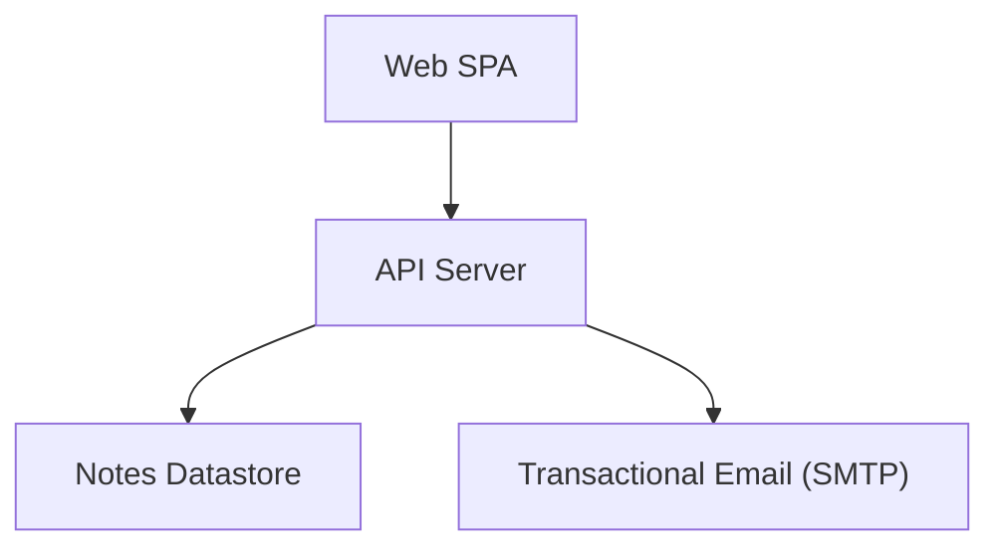
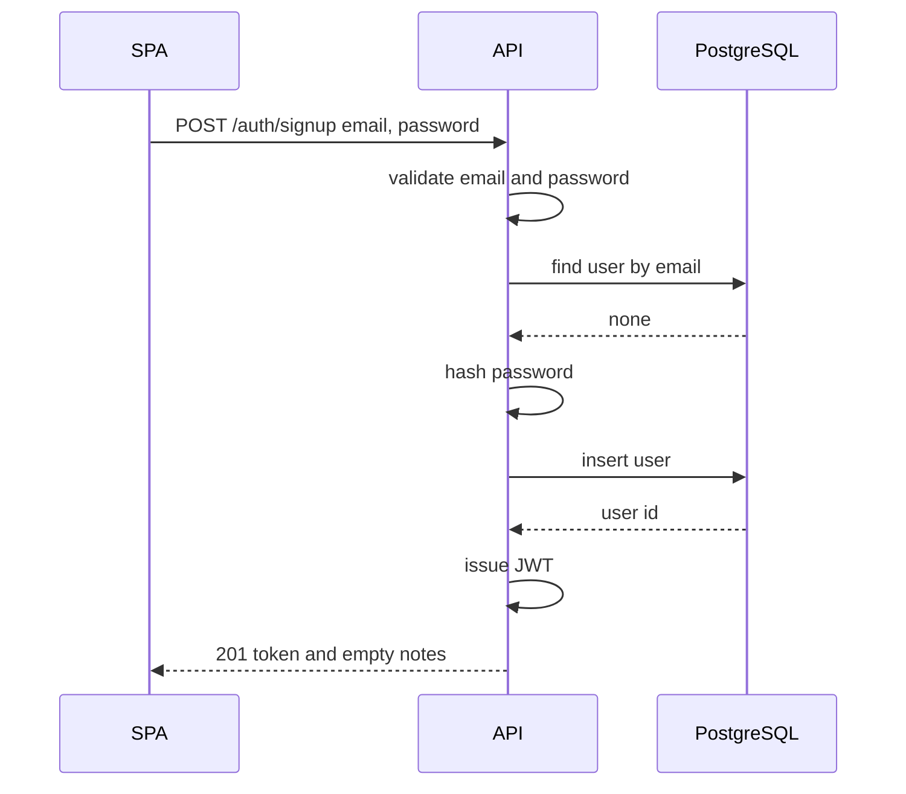
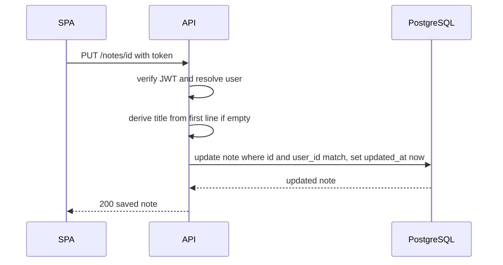
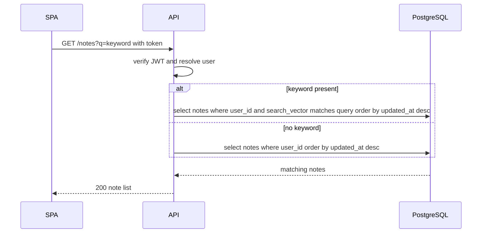
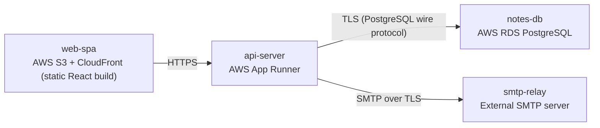

# Architecture

> Maintained by QuorQ AI SDLC. Text between `sdlc:auto` markers is regenerated; anything outside them is yours and is kept.

<!-- sdlc:auto:start narrative -->
## Overview

### ARCH-001 · approved · source: architecture:summary

Overall architecture (v2, approved): a lightweight, responsive personal note-taking web app with a React SPA frontend, FastAPI backend, PostgreSQL datastore, and SMTP-based password reset, run entirely on AWS free tier.

Approved architecture, version 2. A React 19 single-page frontend lets each signed-in user create, edit, delete, list (ordered by most-recently-edited) and keyword-search their own plain-text notes. A FastAPI 0.115 backend handles email/password sign-up and sign-in with JWT-based persistent sessions, enforces per-user privacy on every note operation, derives a note title from its first line when none is given, and sends password-reset emails via an external SMTP server. PostgreSQL 16 durably stores users and notes and performs keyword search with its built-in full-text search, so no separate search service is needed. The whole stack runs in one AWS account on its free tier.

- ⚠ Overview does not cite specific requirement IDs, so this summary-level entry cannot be traced to individual user stories beyond what appears in the tech-decision notes (US-011, US-012).

### ARCH-002 · approved · source: architecture:components:frontend

Web SPA (React 19): sign-up/sign-in screens, a searchable note list ordered by most-recently-edited, and an in-place plain-text editor.

Component: frontend -- Web SPA built with React 19. Provides a responsive single-page UI covering sign-up/sign-in screens, a searchable note list ordered by most-recently-edited, and an in-place plain-text editor designed to feel instant while typing and switching notes. Cited against NFR-004 and US-012 in the technology-decision rationale for React.

**Related:** US-012

### ARCH-003 · approved · source: architecture:components:backend

API Server (FastAPI 0.115) providing authentication and per-user note CRUD plus keyword search, enforcing strict per-user data isolation.

Component: backend -- REST API for authentication (sign-up, sign-in, logout, password reset), persistent JWT sessions, and per-user CRUD plus keyword search over notes. Enforces that users only ever read or write their own notes, derives titles from the first line when none is given, and sends reset emails via SMTP. Implements the full-text-search-backed query capability referenced under US-011.

**Related:** US-011

- ⚠ Input does not explicitly state which requirement IDs besides US-011 the backend as a whole satisfies.

### ARCH-004 · approved · source: architecture:components:database

Notes Datastore (PostgreSQL 16): durable, private storage of accounts and notes with built-in full-text search.

Component: database -- Durable, private storage of accounts and notes, consistent across devices, with full-text search over note title and body using PostgreSQL's built-in tsvector + GIN indexing. Chosen specifically so no separate search system needs to be added (explicitly tied to US-011 in the technology-decision rationale).

**Related:** US-011

### ARCH-005 · approved · source: architecture:components:email

Transactional email via an external SMTP server, used to send password-reset (and optionally verification) messages.

Component: email -- Sends password-reset (and optional verification) messages so a user who forgets their password is not locked out permanently. Delivered via an external SMTP server over TLS.

- ⚠ No requirement ID in the known list is explicitly linked to password-reset/email functionality in this input; traceability to a specific US-xxx is unconfirmed.

### ARCH-006 · approved · source: architecture:critical_path:signup

Critical path for new-user sign-up: validates email, rejects duplicates, hashes password, creates account, issues a session, returns an empty note space.

A new visitor submits a valid email and password. The backend validates the email, rejects duplicates, hashes the password, creates the account, issues a session token, and returns an empty note space.

- ⚠ No explicit requirement ID is attached to this critical path in the input.

### ARCH-007 · approved · source: architecture:critical_path:note_edit

Critical path for creating/editing a note: verifies session, derives title from first line when absent, updates timestamp and search vector, scoped to the user.

A signed-in user saves note text and an optional title. The backend verifies the session, derives the title from the first line when none is given, writes the note with an updated last-edited timestamp scoped to the user, and keeps the full-text search vector current.

- ⚠ No explicit requirement ID is attached to this critical path in the input, though it aligns functionally with title-derivation behavior described under the POST/PUT /notes endpoints.

### ARCH-008 · approved · source: architecture:critical_path:list_search

Critical path for listing and keyword-searching notes: returns only the signed-in user's notes, most-recently-edited first, filtered by PostgreSQL full-text search when a keyword is given.

A signed-in user opens the note list, optionally with a keyword. The backend returns only that user's notes ordered by most-recently-edited, filtering by PostgreSQL full-text search when a query is present. This is the functional path backing the full-text search capability cited against US-011 at the database-decision level.

**Related:** US-011

### ARCH-009 · approved · source: architecture:entities

Data model: three tables -- users, notes, password_reset_tokens -- covering accounts, note content/search, and reset-token lifecycle.

Entities defined: 
- users: id, email, password_hash, created_at.
- notes: id, user_id, title, body, search_vector, created_at, updated_at.
- password_reset_tokens: id, user_id, token_hash, expires_at, used_at, created_at.
The notes.search_vector field backs PostgreSQL full-text search; password_reset_tokens supports expiring, single-use reset tokens.

- ⚠ No explicit requirement IDs are attached to individual entities in the input.

### ARCH-010 · approved · source: architecture:endpoints

Full REST API surface: auth endpoints (signup/login/logout/password-reset) and per-user note CRUD plus keyword search.

Endpoints defined:
- POST /auth/signup: Create an account with email and password; returns a session token and signs the user in to an empty note space. Rejects duplicate email and invalid email/empty password with field-level errors.
- POST /auth/login: Sign in with email and password; returns a session token. Returns an invalid-credentials error on mismatch.
- POST /auth/logout: End the current session.
- POST /auth/password-reset/request: Request a password-reset email via SMTP; always returns success to avoid revealing which emails are registered.
- POST /auth/password-reset/confirm: Set a new password using a valid reset token.
- GET /notes: List the signed-in user's notes ordered by most-recently-edited; optional keyword filter over title and body via full-text search. Returns an empty list when the user has no notes.
- POST /notes: Create a plain-text note; title is derived from the first line when none is given. Sets last-edited timestamp.
- GET /notes/{id}: Fetch one of the signed-in user's notes; returns 404 if it belongs to another user or does not exist.
- PUT /notes/{id}: Update a note's text or title and refresh its last-edited timestamp; re-derives the title from the first line when title is cleared.
- DELETE /notes/{id}: Delete one of the signed-in user's notes; it is removed everywhere the account is used.

**Related:** US-011

- ⚠ Endpoints are not individually mapped to requirement IDs in the input beyond the general US-011 search reference; per-endpoint traceability to US-001..US-013 is not explicit.

### ARCH-011 · approved · source: architecture:deployment_nodes

Deployment topology: static SPA on S3+CloudFront, API on AWS App Runner, PostgreSQL on AWS RDS, and an external SMTP relay -- all within a single AWS account.

Deployment nodes:
- web-spa: AWS S3 + CloudFront, serving static React build assets over HTTPS.
- api-server: AWS App Runner, running FastAPI 0.115 on a Python container.
- notes-db: AWS RDS PostgreSQL 16.
- smtp-relay: External SMTP server, communicating over SMTP/TLS.

- ⚠ No deployment phase input exists yet to confirm these nodes were actually provisioned as designed (see deployment phase gaps).

### ARCH-012 · approved · source: architecture:technology_decisions

Technology choices: React 19 frontend, FastAPI 0.115 backend, PostgreSQL 16 database, AWS cloud -- each chosen with stated alternatives and rationale.

Technology decisions:
- Frontend: React 19 (alternatives considered: Vue, Svelte). Drives the single main screen -- searchable note list plus in-place editor -- with live, instant-feeling editing as users type and switch notes/devices. Cited against NFR-004 and US-012.
- Backend: FastAPI 0.115 (alternatives considered: Flask, Express). Implements a small, clear API surface -- sign-in and per-user note CRUD plus search -- with little code and good performance under light load.
- Database: PostgreSQL 16 (alternatives considered: MySQL, SQLite). Stores accounts and notes durably and consistently across devices and performs keyword search itself via built-in full-text search (tsvector + GIN), avoiding a separate search system. Cited against US-011.
- Cloud: AWS (alternatives considered: GCP, Azure). Runs web, server, database, and email in one account on a free tier, keeping costs near zero while allowing room to grow without re-platforming.

**Related:** US-011, US-012

- ⚠ NFR-004 is referenced in the input but is not present in the known requirement-key list provided for this project; confirm whether it is a tracked non-functional requirement elsewhere.
<!-- sdlc:auto:end narrative -->

<!-- sdlc:auto:start building-blocks -->
## Building Block View

| ID | Name | Technology | Responsibility | Depends on |
|---|---|---|---|---|
| frontend | Web SPA | React 19 | Responsive single-page UI: sign-up/sign-in screens, searchable note list ordered by most-recently-edited, and an in-place plain-text editor that feels instant while typing and switching notes. | backend |
| backend | API Server | FastAPI 0.115 | REST API for authentication (sign-up, sign-in, logout, password reset), persistent JWT sessions, and per-user CRUD plus keyword search over notes. Enforces that users only ever read or write their own notes, derives titles from the first line, and sends reset emails via SMTP. | database, email |
| database | Notes Datastore | PostgreSQL 16 | Durable, private storage of accounts and notes, consistent across devices, with full-text search over note title and body. | — |
| email | Transactional Email (SMTP) | SMTP server | Sends password-reset (and optional verification) messages so a user who forgets their password is not locked out permanently. | — |

<!-- sdlc:auto:end building-blocks -->

<!-- sdlc:auto:start runtime -->
## Runtime View

### Sign up and start a note space

A new visitor submits a valid email and password. The backend validates the email, rejects duplicates, hashes the password, creates the account, issues a session token and returns an empty note space.

- **Components:** frontend, backend, database
- **Modules:** auth_router, auth_service, password_hasher, jwt_service, user_repository
- **Key functions:** signup(email, password), hash_password(password), issue_token(user_id), create_user(email, password_hash)

### Create or edit a note with title fallback

A signed-in user saves note text and optional title. The backend verifies the session, derives the title from the first line when none is given, writes the note with an updated last-edited timestamp scoped to the user, and keeps the full-text search vector current.

- **Components:** frontend, backend, database
- **Modules:** notes_router, notes_service, title_deriver, auth_dependency, note_repository
- **Key functions:** save_note(user_id, note_id, title, body), derive_title(title, body), upsert_note(user_id, data)

### List and keyword-search my notes

A signed-in user opens the note list, optionally with a keyword. The backend returns only that user's notes ordered by most-recently-edited, filtering by PostgreSQL full-text search when a query is present.

- **Components:** frontend, backend, database
- **Modules:** notes_router, notes_service, auth_dependency, note_repository
- **Key functions:** list_notes(user_id, query), search_notes(user_id, query)

<!-- sdlc:auto:end runtime -->

<!-- sdlc:auto:start deployment-view -->
## Deployment View

| Name | Service | Runtime | Scaling | Environment |
|---|---|---|---|---|
| web-spa | AWS S3 + CloudFront (static React build) | Static assets over HTTPS | CDN edge caching, serverless scale | dev |
| api-server | AWS App Runner | FastAPI 0.115 on Python container | Scale-to-low on light load, auto-scale on requests | dev |
| notes-db | AWS RDS PostgreSQL | PostgreSQL 16 | Single free-tier instance, vertical scale later | dev |
| smtp-relay | External SMTP server | SMTP over TLS | Provider-managed | dev |

| Source | Target | Protocol |
|---|---|---|
| web-spa | api-server | HTTPS |
| api-server | notes-db | TLS (PostgreSQL wire protocol) |
| api-server | smtp-relay | SMTP over TLS |

<!-- sdlc:auto:end deployment-view -->

<!-- sdlc:auto:start decisions -->
## Architecture Decisions

| Layer | Choice | ADR |
|---|---|---|
| Frontend | React 19 | [ADR-0001](adr/frontend.md) |
| Backend | FastAPI 0.115 | [ADR-0002](adr/backend.md) |
| Database | PostgreSQL 16 | [ADR-0003](adr/database.md) |
| Cloud | AWS | [ADR-0004](adr/cloud.md) |
<!-- sdlc:auto:end decisions -->

<!-- sdlc:auto:start links -->
## Related Documents

- [Data Model](data-model.md)
- [API Specification](api/openapi.yaml)
- [Architecture Decision Records](adr/README.md)
<!-- sdlc:auto:end links -->
