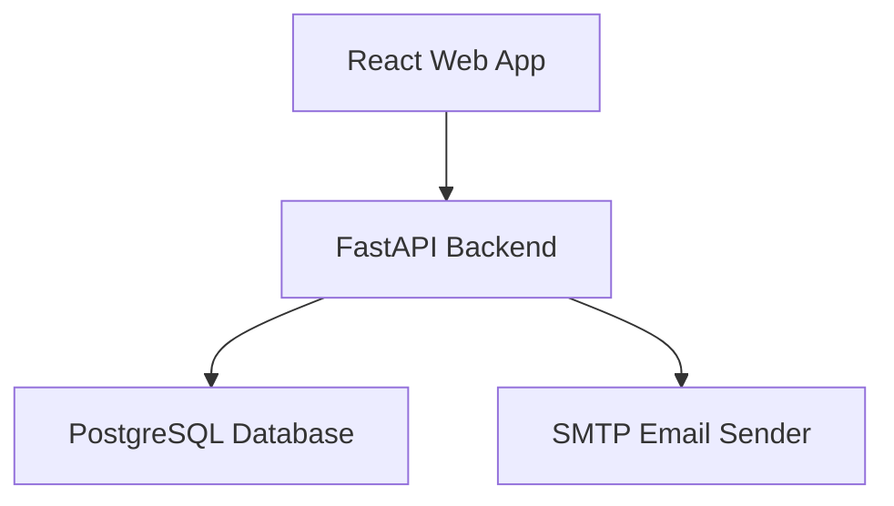
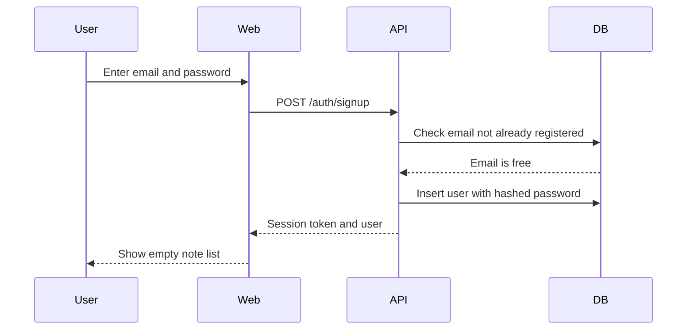
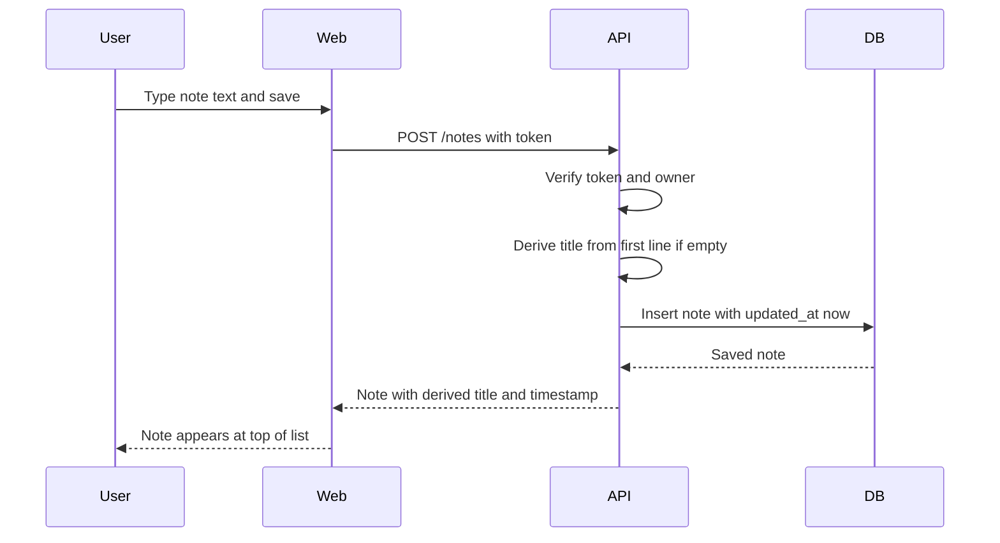
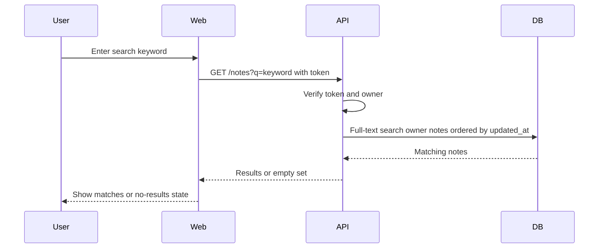
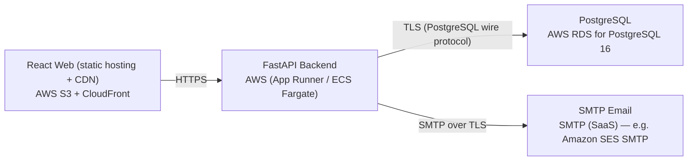

# Architecture

> Maintained by QuorQ AI SDLC. Text between `sdlc:auto` markers is regenerated; anything outside them is yours and is kept.

<!-- sdlc:auto:start narrative -->
## Overview

### ARCH-001 · approved · source: architecture:summary

Overall architecture approved, version 1, for a lightweight personal note-taking web app: React 19 SPA + FastAPI 0.115 backend + PostgreSQL 16 + SMTP email, all on AWS free tier.

The system is a responsive single-page app with email/password sign-in, one main screen with a searchable note list (ordered by recently edited) and an in-place plain-text editor. The backend handles sign-up, persistent-token sign-in, per-user note CRUD, first-line title fallback, and keyword search. PostgreSQL stores accounts and notes and performs keyword search itself via built-in full-text search (tsvector + GIN), avoiding a separate search service. Password-reset email goes through the approved SMTP service. The author states this revision reviewed every story, NFR, the approved stack, and services against the prior design and found it still holds in full, keeping component ids (web, api, db, email) and all endpoint paths stable, with only a minor wording clean-up to the data-model notes clarifying the index description.

- ⚠ Input labels this 'Version: 1' but also describes it as a revision review against 'the previously approved architecture' -- the prior version's content was not supplied, so the claim that scope is unchanged cannot be independently verified.
- ⚠ No explicit mapping from architecture components/endpoints to specific requirement ids (US-001..US-013) was included in the input, so related_ids could not be populated for most entries without guessing.

### ARCH-WEB · approved · source: architecture:components:web

React 19 single-page frontend component: sign-up/sign-in screens, note list, in-place editor, search, sign-out.

Responsive SPA built with React 19. Provides sign-up/sign-in screens, a note list ordered by last edited, a plain-text editor with instant typing, keyword search, and sign-out. Keeps the session token client-side and enforces that notes are shown only when signed in. Built as a static bundle served from S3 + CloudFront.

### ARCH-API · approved · source: architecture:components:api

FastAPI 0.115 backend component: authentication, session tokens, per-user note CRUD, search, password-reset trigger.

Authenticates users via email/password, issues and verifies persistent session tokens, scopes every note operation to the signed-in owner, serves note CRUD, recently-edited ordering and keyword search, derives note titles from the first line when none given, and triggers password-reset emails. Pydantic models validate email/password inputs; async stack targets fast response under light personal-app load.

### ARCH-DB · approved · source: architecture:components:db

PostgreSQL 16 database component: durable per-user storage of accounts and notes with built-in full-text search.

Durable, private storage of accounts and notes; enforces per-user ownership; provides keyword search over note title and body using PostgreSQL's built-in full-text search (tsvector + GIN index); keeps data consistent across a user's devices. This revision made a minor wording clarification to the index description in the data-model notes (no structural change).

### ARCH-EMAIL · approved · source: architecture:components:email

SMTP email sender component: transactional password-reset (and optional verification) emails.

Sends the few transactional emails required -- password reset and optionally account verification -- via an SMTP SaaS service running through AWS (e.g. Amazon SES SMTP), so a user who forgets their password is not locked out.

- ⚠ Input says 'optional verification' email but does not state whether verification is actually in scope for this build -- status is ambiguous.

### ARCH-CP-SIGNUP · approved · source: architecture:critical_paths:sign_up_and_sign_in

Critical path for account creation and sign-in using persistent session tokens.

A new visitor registers with email and password; duplicate emails and invalid/empty fields are rejected. On success the user is signed into an empty note space. Returning users sign in to see their existing note list. A persistent token keeps the session active across visits and devices.

### ARCH-CP-NOTEEDIT · approved · source: architecture:critical_paths:create_or_edit_note

Critical path for creating/editing a note with automatic title fallback and recency ordering.

A signed-in user writes plain text; the backend stores it scoped to the owner, sets the last-edited timestamp to now, and derives the title from the first line when none is given. The note then sorts to the top of the list and syncs across every device.

### ARCH-CP-SEARCH · approved · source: architecture:critical_paths:list_and_keyword_search

Critical path for listing notes by recency and filtering them via keyword full-text search.

The user's notes load ordered by most recently edited, each showing its last-edited timestamp. Entering a keyword filters to notes whose title or body matches, using PostgreSQL full-text search. Clearing the keyword restores the full ordered list.

### ARCH-DATA · approved · source: architecture:entities

Data model: users, notes, and password_resets tables.

users: id, email, password_hash, created_at. notes: id, user_id, title, body, search_vector, created_at, updated_at (search_vector backs PostgreSQL full-text search over title and body). password_resets: id, user_id, token_hash, expires_at, used_at, supporting the password-reset email flow.

### ARCH-API-ENDPOINTS · approved · source: architecture:endpoints

Full REST API surface for auth, password reset, and note CRUD/search, kept stable across this revision.

Auth: POST /auth/signup (create account, reject duplicates/invalid fields, returns session token); POST /auth/login (sign in, returns persistent token); POST /auth/logout (end session); GET /auth/me (restore persistent session). Password reset: POST /auth/password-reset/request (send reset email via SMTP if email exists); POST /auth/password-reset/confirm (set new password with valid token). Notes: GET /notes (list by most recently edited, optional keyword filter via full-text search); POST /notes (create note, title fallback from first line, sets last-edited); GET /notes/{id} (fetch single owned note); PUT /notes/{id} (edit text/title, re-derives title fallback, updates last-edited); DELETE /notes/{id} (delete owned note). All endpoint paths are stated as kept stable from the prior design in this revision.

### ARCH-DEPLOY · approved · source: architecture:deployment_nodes

Deployment topology: static web on S3/CloudFront, API on AWS App Runner/ECS Fargate, PostgreSQL on RDS, SMTP SaaS for email -- all in one AWS account on the free tier.

React Web: static build (React 19) hosted on AWS S3 + CloudFront. FastAPI Backend: Python 3.12, Uvicorn, FastAPI 0.115, running on AWS App Runner or ECS Fargate. PostgreSQL: AWS RDS for PostgreSQL 16. SMTP Email: SaaS SMTP relay (e.g. Amazon SES SMTP). The whole app runs in a single AWS account on the free tier.

- ⚠ Choice between App Runner and ECS Fargate for the backend is left open ('App Runner / ECS Fargate') -- final selection not recorded in input.

### ARCH-TECH · approved · source: architecture:technology_decisions

Key technology choices and their rationale: React 19, FastAPI 0.115, PostgreSQL 16, AWS.

Frontend -- React 19 (alternatives considered: Vue, Svelte): drives the single main screen (live note list, in-place editor needing instant feel while typing/switching notes per NFR-004) and renders the responsive layout across phone/tablet/desktop (NFR-003); built as a static bundle on S3+CloudFront. Backend -- FastAPI 0.115 (alternatives: Flask, Django): handles email/password auth, persistent token sessions, per-user note CRUD/search; Pydantic validates inputs; async stack stays fast under light personal-app load. Database -- PostgreSQL 16 (alternatives: MySQL, SQLite): durably/privately stores accounts and notes with per-user ownership, stays consistent across devices, performs keyword search itself via built-in full-text search (tsvector + GIN) with no separate search service needed. Cloud -- AWS (alternatives: GCP, Azure): runs static web, API, database, and email in one account on the free tier, keeping early costs near zero while leaving room to scale.

- ⚠ NFR-003 and NFR-004 are referenced as rationale but are not present in the known requirement keys list (US-001..US-013) supplied for this phase, so they could not be linked via related_ids.
<!-- sdlc:auto:end narrative -->

<!-- sdlc:auto:start building-blocks -->
## Building Block View

| ID | Name | Technology | Responsibility | Depends on |
|---|---|---|---|---|
| web | React Web App | React 19 | Responsive SPA: sign-up/sign-in screens, note list ordered by last edited, plain-text editor with instant typing, keyword search, and sign-out. Keeps the session token and enforces showing notes only when signed in. | api |
| api | FastAPI Backend | FastAPI 0.115 | Authenticates users (email/password), issues and verifies persistent session tokens, scopes every note operation to the signed-in owner, serves note CRUD, recently-edited ordering and keyword search, derives note titles from the first line, and triggers password-reset emails. | db, email |
| db | PostgreSQL Database | PostgreSQL 16 | Durable, private storage of accounts and notes; enforces per-user ownership; provides keyword search over note title and body using built-in full-text search; keeps data consistent across a user's devices. | — |
| email | SMTP Email Sender | SMTP (SaaS) via AWS | Sends the few transactional emails (password reset and optional verification) so a user who forgets their password is not locked out. | — |

<!-- sdlc:auto:end building-blocks -->

<!-- sdlc:auto:start runtime -->
## Runtime View

### Sign up and sign in

New visitor registers with email and password (rejecting duplicates and invalid/empty fields), is signed into an empty note space, and returning users sign in to their note list. A persistent token keeps the session across visits and devices.

- **Components:** web, api, db
- **Modules:** auth_router, auth_service, password_hasher, token_manager, user_repository
- **Key functions:** sign_up(email, password), sign_in(email, password), hash_password(password), verify_password(password, hash), issue_token(user_id), verify_token(token)

### Create or edit a note with title fallback

A signed-in user writes plain text; the backend stores it scoped to the owner, sets the last-edited timestamp to now, and derives the title from the first line when none is given. The note then sorts to the top of the list and syncs to every device.

- **Components:** web, api, db
- **Modules:** note_router, note_service, title_deriver, note_repository
- **Key functions:** create_note(user_id, title, body), update_note(user_id, note_id, title, body), derive_title(title, body), touch_last_edited(note_id)

### List and keyword search

The user's notes load ordered by most recently edited, each with its last-edited timestamp. A keyword filters to notes whose title or body matches using PostgreSQL full-text search; clearing it restores the ordered list.

- **Components:** web, api, db
- **Modules:** note_router, note_service, search_query, note_repository
- **Key functions:** list_notes(user_id), search_notes(user_id, keyword)

<!-- sdlc:auto:end runtime -->

<!-- sdlc:auto:start deployment-view -->
## Deployment View

| Name | Service | Runtime | Scaling | Environment |
|---|---|---|---|---|
| React Web (static hosting + CDN) | AWS S3 + CloudFront | Static build (React 19) | CDN edge caching | dev |
| FastAPI Backend | AWS (App Runner / ECS Fargate) | Python 3.12, Uvicorn, FastAPI 0.115 | Single small instance for dev, scales horizontally later | dev |
| PostgreSQL | AWS RDS for PostgreSQL 16 | PostgreSQL 16 | Single db.t-class free-tier instance | dev |
| SMTP Email | SMTP (SaaS) — e.g. Amazon SES SMTP | SMTP relay | Managed | dev |

| Source | Target | Protocol |
|---|---|---|
| React Web (static hosting + CDN) | FastAPI Backend | HTTPS |
| FastAPI Backend | PostgreSQL | TLS (PostgreSQL wire protocol) |
| FastAPI Backend | SMTP Email | SMTP over TLS |

<!-- sdlc:auto:end deployment-view -->

<!-- sdlc:auto:start decisions -->
## Architecture Decisions

| Layer | Choice | ADR |
|---|---|---|
| Frontend | React 19 | [ADR-0001](adr/frontend.md) |
| Backend | FastAPI 0.115 | [ADR-0002](adr/backend.md) |
| Database | PostgreSQL 16 | [ADR-0003](adr/database.md) |
| Cloud | AWS | [ADR-0004](adr/cloud.md) |
<!-- sdlc:auto:end decisions -->

<!-- sdlc:auto:start links -->
## Related Documents

- [Data Model](data-model.md)
- [API Specification](api/openapi.yaml)
- [Architecture Decision Records](adr/README.md)
<!-- sdlc:auto:end links -->
