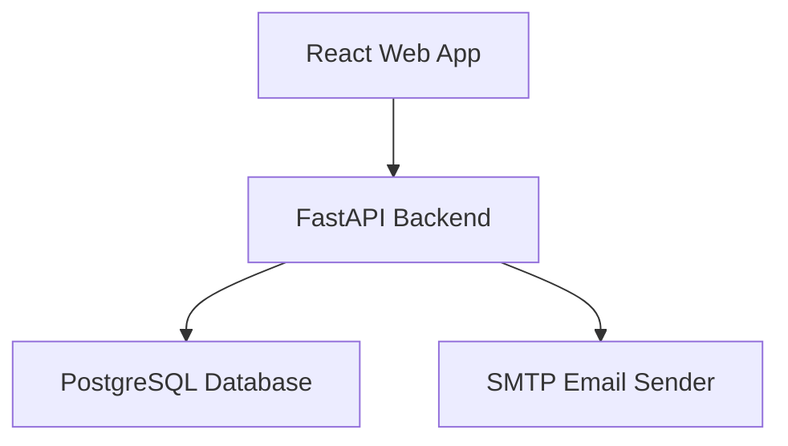
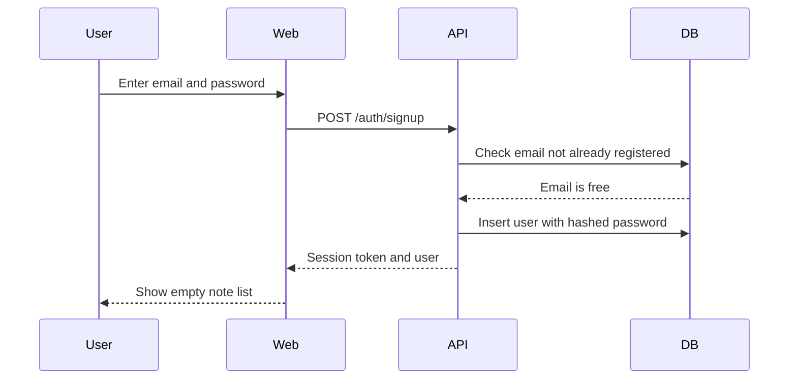
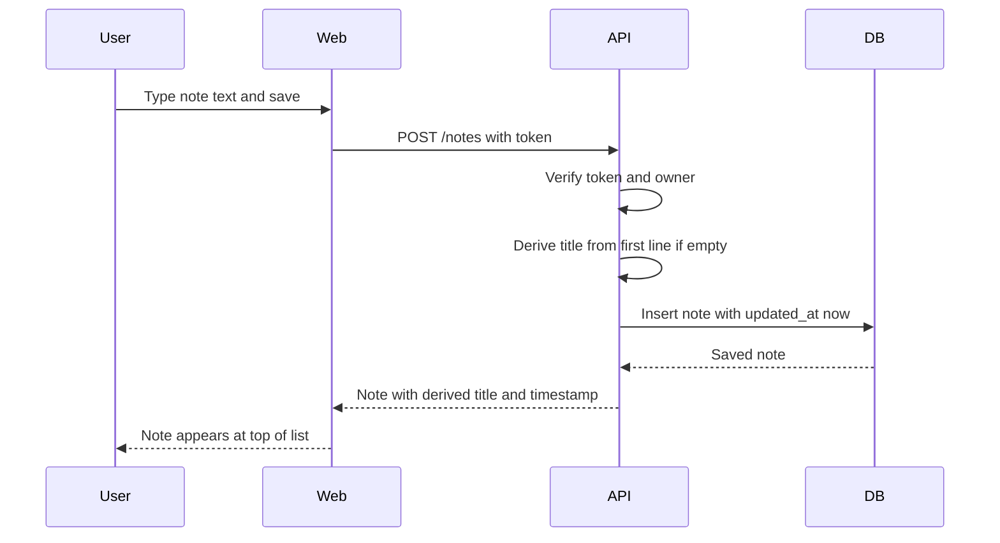
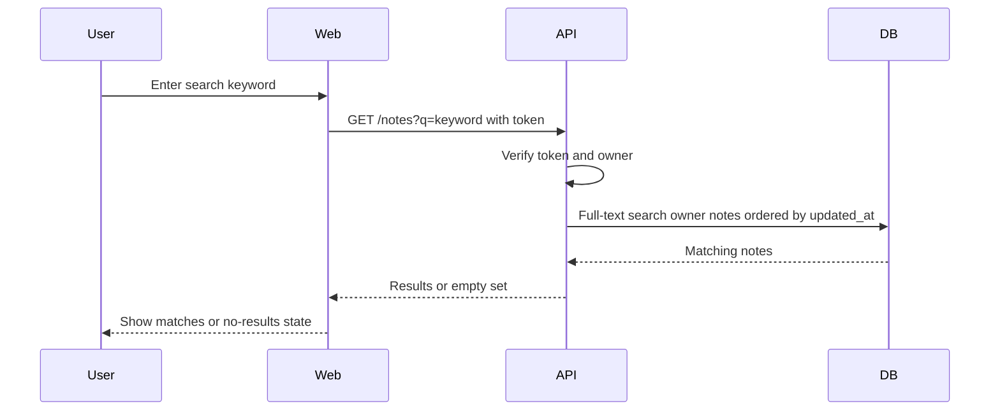
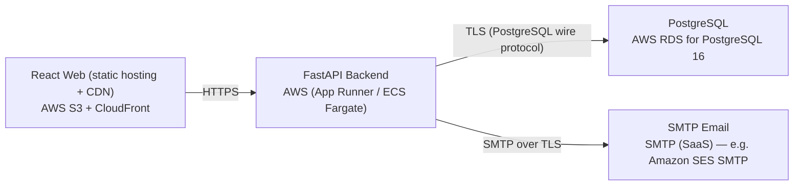

# Architecture

> Maintained by QuorQ AI SDLC. Text between `sdlc:auto` markers is regenerated; anything outside them is yours and is kept.

<!-- sdlc:auto:start narrative -->
## Overview

### ARCH-000 · approved · source: architecture:summary

Overall architecture for the Simple Note Pad app: a React 19 SPA, FastAPI 0.115 backend, PostgreSQL 16 database, and SMTP email sender, all hosted in one AWS account on the free tier.

Approved, version 2. The system is a lightweight, responsive personal note-taking web app. The React 19 SPA provides sign-in/sign-up and one main screen with a searchable, recently-edited-ordered note list plus an in-place plain-text editor. FastAPI 0.115 handles email/password auth with persistent token sessions and owns per-user note CRUD and keyword search. PostgreSQL 16 durably stores accounts and notes and performs keyword search via built-in full-text search (no separate search engine needed). Transactional password-reset email is sent via an approved SMTP service. The whole app runs in a single AWS account on the free tier.

- ⚠ Input does not list which specific US-00x requirements this architecture version satisfies or supersedes from version 1; only inferred from component/critical-path descriptions.

### ARCH-COMP-web · approved · source: architecture:components.web

React 19 single-page web app providing sign-up/sign-in, the note list, and the in-place plain-text editor.

Component 'web': React Web App (React 19). Responsible for sign-up/sign-in screens, a note list ordered by last edited, a plain-text editor with instant typing, keyword search, and sign-out. Keeps the session token client-side and enforces that notes are shown only when signed in.

- ⚠ No explicit requirement IDs (US-00x) are cited in the input for this component; linkage would need confirmation against the requirements phase.

### ARCH-COMP-api · approved · source: architecture:components.api

FastAPI 0.115 backend handling authentication, session tokens, and per-user note CRUD/search.

Component 'api': FastAPI Backend (FastAPI 0.115). Authenticates users via email/password, issues and verifies persistent session tokens, scopes every note operation to the signed-in owner, serves note CRUD, recently-edited ordering and keyword search, derives note titles from the first line when none is given, and triggers password-reset emails.

- ⚠ No explicit requirement IDs (US-00x) are cited in the input for this component; linkage would need confirmation against the requirements phase.

### ARCH-COMP-db · approved · source: architecture:components.db

PostgreSQL 16 database for durable, private storage of accounts and notes with built-in keyword search.

Component 'db': PostgreSQL Database (PostgreSQL 16). Provides durable, private storage of accounts and notes, enforces per-user ownership, provides keyword search over note title and body via built-in full-text search, and keeps data consistent across a user's devices.

- ⚠ No explicit requirement IDs (US-00x) are cited in the input for this component; linkage would need confirmation against the requirements phase.

### ARCH-COMP-email · approved · source: architecture:components.email

SMTP-based email sender used for transactional password-reset (and optional verification) emails.

Component 'email': SMTP Email Sender (SMTP (SaaS) via AWS). Sends the few transactional emails (password reset and optional verification) so a user who forgets their password is not locked out.

- ⚠ No explicit requirement IDs (US-00x) are cited in the input for this component; linkage would need confirmation against the requirements phase.
- ⚠ Input says 'optional verification' email without clarifying whether email verification is in scope for this version — flagged as ambiguous.

### ARCH-CP-signup-signin · approved · source: architecture:critical_paths.signup_signin

Critical path covering account registration and sign-in, including duplicate/invalid rejection and persistent sessions.

New visitor registers with email and password; the system rejects duplicate emails and invalid/empty fields, then signs the new user into an empty note space. Returning users sign in to see their existing note list. A persistent token keeps the session active across visits and devices.

- ⚠ No explicit requirement IDs (US-00x) are cited in the input for this critical path; linkage would need confirmation against the requirements phase.

### ARCH-CP-create-edit · approved · source: architecture:critical_paths.create_edit_note

Critical path for creating or editing a note, including title fallback from the first line and recency-based sorting.

A signed-in user writes plain text; the backend stores it scoped to the owner, sets the last-edited timestamp to now, and derives the title from the first line when none is explicitly given. The note then sorts to the top of the list and syncs to every device the user signs into.

- ⚠ No explicit requirement IDs (US-00x) are cited in the input for this critical path; linkage would need confirmation against the requirements phase.

### ARCH-CP-list-search · approved · source: architecture:critical_paths.list_search

Critical path for listing notes by recency and filtering them with keyword search.

The user's notes load ordered by most recently edited, each showing its last-edited timestamp. Entering a keyword filters to notes whose title or body match, using PostgreSQL full-text search. Clearing the keyword restores the full, recency-ordered list.

- ⚠ No explicit requirement IDs (US-00x) are cited in the input for this critical path; linkage would need confirmation against the requirements phase.

### ARCH-DATA-MODEL · approved · source: architecture:entities

Three data entities: users, notes, and password_resets, forming the persistent schema in PostgreSQL.

users: id, email, password_hash, created_at. notes: id, user_id, title, body, search_vector, created_at, updated_at (search_vector backs PostgreSQL full-text search over title/body). password_resets: id, user_id, token_hash, expires_at, used_at (supports the password-reset flow with expiring, single-use tokens).

- ⚠ No explicit requirement IDs (US-00x) are cited in the input for this data model; linkage would need confirmation against the requirements phase.

### ARCH-API-AUTH · approved · source: architecture:endpoints.auth

Authentication and session endpoints: signup, login, logout, session restore, and password reset.

POST /auth/signup — create an account with email and password; rejects duplicate emails and invalid/empty fields; returns a session token. POST /auth/login — sign in with email and password; returns a persistent session token. POST /auth/logout — end the current session. GET /auth/me — return the signed-in user; used to restore a persistent session on return. POST /auth/password-reset/request — send a password-reset email via SMTP if the email exists. POST /auth/password-reset/confirm — set a new password using a valid reset token.

**Related:** ARCH-CP-signup-signin, ARCH-COMP-api

- ⚠ No explicit requirement IDs (US-00x) are cited in the input for these endpoints; linkage would need confirmation against the requirements phase.

### ARCH-API-NOTES · approved · source: architecture:endpoints.notes

Note CRUD and search endpoints, all scoped to the signed-in owner.

GET /notes — list the signed-in user's notes ordered by most recently edited; optional keyword filter on title and body via full-text search. POST /notes — create a plain-text note for the signed-in user; derives title from first line when none given; sets last-edited to now. GET /notes/{id} — fetch a single note owned by the signed-in user. PUT /notes/{id} — edit a note's text or title; re-derives title fallback and updates last-edited timestamp. DELETE /notes/{id} — delete a note owned by the signed-in user.

**Related:** ARCH-CP-create-edit, ARCH-CP-list-search, ARCH-COMP-api

- ⚠ No explicit requirement IDs (US-00x) are cited in the input for these endpoints; linkage would need confirmation against the requirements phase.

### ARCH-DEPLOY · approved · source: architecture:deployment_nodes

Deployment topology: static web hosting via S3/CloudFront, API on AWS App Runner/ECS Fargate, managed PostgreSQL via RDS, and SMTP SaaS for email.

React Web: static build (React 19) served via AWS S3 + CloudFront (static hosting + CDN). FastAPI Backend: Python 3.12, Uvicorn, FastAPI 0.115, running on AWS App Runner / ECS Fargate. PostgreSQL: AWS RDS for PostgreSQL 16. SMTP Email: SMTP SaaS relay (e.g., Amazon SES SMTP). The full stack runs in one AWS account on the free tier per the architecture summary.

**Related:** ARCH-COMP-web, ARCH-COMP-api, ARCH-COMP-db, ARCH-COMP-email

### ARCH-TECH-frontend · approved · source: architecture:technology_decisions.frontend

Frontend technology choice: React 19, selected over Vue and Svelte.

React 19 drives the single main screen — a live note list and in-place plain-text editor that must feel instant while typing and switching notes (NFR-004) — and renders the responsive layout across phone, tablet and desktop (NFR-003). Built as a static bundle served from S3 + CloudFront. Alternatives considered: Vue, Svelte.

**Related:** NFR-003, NFR-004

- ⚠ NFR-003 and NFR-004 are referenced by the architecture input but are not in the known requirement key list (US-001..US-013); confirm these NFR IDs exist in the requirements phase.

### ARCH-TECH-backend · approved · source: architecture:technology_decisions.backend

Backend technology choice: FastAPI 0.115, selected over Flask and Django.

FastAPI 0.115 handles the small, clear surface: email/password auth, persistent token sessions, and per-user note CRUD and search. Pydantic models validate email/password inputs, and the async stack stays fast under light personal-app load. Alternatives considered: Flask, Django.

- ⚠ No explicit requirement IDs (US-00x) are cited in the input for this decision; linkage would need confirmation against the requirements phase.

### ARCH-TECH-database · approved · source: architecture:technology_decisions.database

Database technology choice: PostgreSQL 16, selected over MySQL and SQLite.

PostgreSQL 16 durably and privately stores accounts and notes with per-user ownership, stays consistent as a user edits from several devices, and performs keyword search itself via built-in full-text search (tsvector + GIN index) — no separate search service needed. Alternatives considered: MySQL, SQLite.

- ⚠ No explicit requirement IDs (US-00x) are cited in the input for this decision; linkage would need confirmation against the requirements phase.

### ARCH-TECH-cloud · approved · source: architecture:technology_decisions.cloud

Cloud platform choice: AWS, selected over GCP and Azure.

AWS runs the whole app — static web, API, database and email — in one account on the free tier, keeping early costs near zero and leaving room to scale quietly if more people sign up. Alternatives considered: GCP, Azure.

- ⚠ No explicit requirement IDs (US-00x) are cited in the input for this decision; linkage would need confirmation against the requirements phase.
<!-- sdlc:auto:end narrative -->

<!-- sdlc:auto:start building-blocks -->
## Building Block View

| ID | Name | Technology | Responsibility | Depends on |
|---|---|---|---|---|
| web | React Web App | React 19 | Responsive SPA: sign-up/sign-in screens, note list ordered by last edited, plain-text editor with instant typing, keyword search, and sign-out. Keeps the session token and enforces showing notes only when signed in. | api |
| api | FastAPI Backend | FastAPI 0.115 | Authenticates users (email/password), issues and verifies persistent session tokens, scopes every note operation to the signed-in owner, serves note CRUD, recently-edited ordering and keyword search, derives note titles from the first line, and triggers password-reset emails. | db, email |
| db | PostgreSQL Database | PostgreSQL 16 | Durable, private storage of accounts and notes; enforces per-user ownership; provides keyword search over note title and body using built-in full-text search; keeps data consistent across a user's devices. | — |
| email | SMTP Email Sender | SMTP (SaaS) via AWS | Sends the few transactional emails (password reset and optional verification) so a user who forgets their password is not locked out. | — |

<!-- sdlc:auto:end building-blocks -->

<!-- sdlc:auto:start runtime -->
## Runtime View

### Sign up and sign in

New visitor registers with email and password (rejecting duplicates and invalid/empty fields), is signed into an empty note space, and returning users sign in to their note list. A persistent token keeps the session across visits and devices.

- **Components:** web, api, db
- **Modules:** auth_router, auth_service, password_hasher, token_manager, user_repository
- **Key functions:** sign_up(email, password), sign_in(email, password), hash_password(password), verify_password(password, hash), issue_token(user_id), verify_token(token)

### Create or edit a note with title fallback

A signed-in user writes plain text; the backend stores it scoped to the owner, sets the last-edited timestamp to now, and derives the title from the first line when none is given. The note then sorts to the top of the list and syncs to every device.

- **Components:** web, api, db
- **Modules:** note_router, note_service, title_deriver, note_repository
- **Key functions:** create_note(user_id, title, body), update_note(user_id, note_id, title, body), derive_title(title, body), touch_last_edited(note_id)

### List and keyword search

The user's notes load ordered by most recently edited, each with its last-edited timestamp. A keyword filters to notes whose title or body matches using PostgreSQL full-text search; clearing it restores the ordered list.

- **Components:** web, api, db
- **Modules:** note_router, note_service, search_query, note_repository
- **Key functions:** list_notes(user_id), search_notes(user_id, keyword)

<!-- sdlc:auto:end runtime -->

<!-- sdlc:auto:start deployment-view -->
## Deployment View

| Name | Service | Runtime | Scaling | Environment |
|---|---|---|---|---|
| React Web (static hosting + CDN) | AWS S3 + CloudFront | Static build (React 19) | CDN edge caching | dev |
| FastAPI Backend | AWS (App Runner / ECS Fargate) | Python 3.12, Uvicorn, FastAPI 0.115 | Single small instance for dev, scales horizontally later | dev |
| PostgreSQL | AWS RDS for PostgreSQL 16 | PostgreSQL 16 | Single db.t-class free-tier instance | dev |
| SMTP Email | SMTP (SaaS) — e.g. Amazon SES SMTP | SMTP relay | Managed | dev |

| Source | Target | Protocol |
|---|---|---|
| React Web (static hosting + CDN) | FastAPI Backend | HTTPS |
| FastAPI Backend | PostgreSQL | TLS (PostgreSQL wire protocol) |
| FastAPI Backend | SMTP Email | SMTP over TLS |

<!-- sdlc:auto:end deployment-view -->

<!-- sdlc:auto:start decisions -->
## Architecture Decisions

| Layer | Choice | ADR |
|---|---|---|
| Frontend | React 19 | [ADR-0001](adr/frontend.md) |
| Backend | FastAPI 0.115 | [ADR-0002](adr/backend.md) |
| Database | PostgreSQL 16 | [ADR-0003](adr/database.md) |
| Cloud | AWS | [ADR-0004](adr/cloud.md) |
<!-- sdlc:auto:end decisions -->

<!-- sdlc:auto:start links -->
## Related Documents

- [Data Model](data-model.md)
- [API Specification](api/openapi.yaml)
- [Architecture Decision Records](adr/README.md)
<!-- sdlc:auto:end links -->
