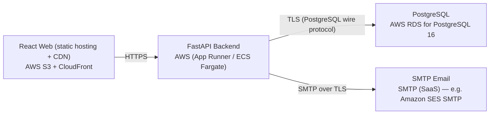

# Deployment Guide

> Maintained by QuorQ AI SDLC. Text between `sdlc:auto` markers is regenerated; anything outside them is yours and is kept.

<!-- sdlc:auto:start how-it-deploys -->
Pushes to `main` run `.github/workflows/deploy.yml`, which builds the API image (if there is a backend) and deploys the SPA to AWS Amplify. Commits touching only `docs/sdlc/**` don't deploy. Deployments can also be started from the platform's Deployment tab.
<!-- sdlc:auto:end how-it-deploys -->

<!-- sdlc:auto:start environments -->
| Name | Service | Runtime | Scaling | Environment |
|---|---|---|---|---|
| React Web (static hosting + CDN) | AWS S3 + CloudFront | Static build (React 19) | CDN edge caching | dev |
| FastAPI Backend | AWS (App Runner / ECS Fargate) | Python 3.12, Uvicorn, FastAPI 0.115 | Single small instance for dev, scales horizontally later | dev |
| PostgreSQL | AWS RDS for PostgreSQL 16 | PostgreSQL 16 | Single db.t-class free-tier instance | dev |
| SMTP Email | SMTP (SaaS) — e.g. Amazon SES SMTP | SMTP relay | Managed | dev |
<!-- sdlc:auto:end environments -->

<!-- sdlc:auto:start live -->
_Not deployed yet._
<!-- sdlc:auto:end live -->

<!-- sdlc:auto:start topology -->

<!-- sdlc:auto:end topology -->
