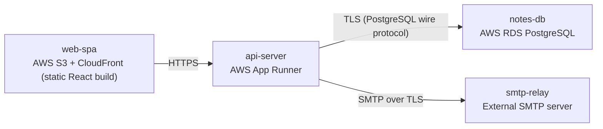

# Deployment Guide

> Maintained by QuorQ AI SDLC. Text between `sdlc:auto` markers is regenerated; anything outside them is yours and is kept.

<!-- sdlc:auto:start how-it-deploys -->
Pushes to `main` run `.github/workflows/deploy.yml`, which builds the API image (if there is a backend) and deploys the SPA to AWS Amplify. Commits touching only `docs/sdlc/**` don't deploy. Deployments can also be started from the platform's Deployment tab.
<!-- sdlc:auto:end how-it-deploys -->

<!-- sdlc:auto:start environments -->
| Name | Service | Runtime | Scaling | Environment |
|---|---|---|---|---|
| web-spa | AWS S3 + CloudFront (static React build) | Static assets over HTTPS | CDN edge caching, serverless scale | dev |
| api-server | AWS App Runner | FastAPI 0.115 on Python container | Scale-to-low on light load, auto-scale on requests | dev |
| notes-db | AWS RDS PostgreSQL | PostgreSQL 16 | Single free-tier instance, vertical scale later | dev |
| smtp-relay | External SMTP server | SMTP over TLS | Provider-managed | dev |
<!-- sdlc:auto:end environments -->

<!-- sdlc:auto:start live -->
_Not deployed yet._
<!-- sdlc:auto:end live -->

<!-- sdlc:auto:start topology -->

<!-- sdlc:auto:end topology -->
